# ForgeAI — The Agent That Builds Agents

ForgeAI is a domain-agnostic factory that takes a one-paragraph brief and a folder of documents, interviews the requester, verifies document groundability, generates a declarative YAML agent definition, builds a source-verified evaluation suite, runs a bounded critic-optimizer loop, and ships an honest quality report alongside a runnable agent.

## Architecture

```mermaid
flowchart LR
    A["brief + docs/"] --> B["1. Ingest + Profile<br/>(BM25 + Dense RRF)"]
    B --> C["2. Intake<br/>(<= 5 questions)"]
    C --> D["3. Groundability Guard<br/>(verified quotes)"]
    D --> E["4. Agent Generator<br/>(rule-gated tools)"]
    E --> F["5. Eval Generator<br/>(dev / held-out split)"]
    F --> G["6. Runtime + Judge<br/>(deterministic + claims)"]
    G --> H["7. Critic-Optimizer<br/>(max 3 iters, diff/leak guards)"]
    H -->|dev improves| G
    H -->|held-out once| I["8. Honest Report<br/>(report.md + definition.yaml)"]
```



## Installation

Requires **Python 3.11+**.

```bash
python3.11 -m venv .venv
source .venv/bin/activate
pip install -e .
```

## Model Setup (Ollama / OpenAI-Compatible)

Default models in [forge.toml](forge.toml) use separate model families for the agent and the judge/eval-writer to reduce self-preference bias:

- **Agent**: `qwen2.5:3b-instruct`
- **Judge / Eval Writer**: `llama3.1:8b`
- **Embeddings**: `nomic-embed-text`

Start Ollama and pull the models:

```bash
ollama serve
ollama pull qwen2.5:3b-instruct
ollama pull llama3.1:8b
ollama pull nomic-embed-text
```

To use an OpenAI-compatible endpoint instead, copy `.env.example` to `.env`, set `FORGE_PROVIDER=openai_compat`, `FORGE_OPENAI_COMPAT_BASE_URL`, and `FORGE_OPENAI_API_KEY`.

## Quickstart

Run the entire factory unattended (`--auto`), with optional `--fast` or `--time-budget-min`:

```bash
forge run \
  --brief path/to/brief.txt \
  --docs path/to/docs \
  --out runs/my_agent \
  --auto \
  --fast \
  --time-budget-min 10
```

Resume an interrupted run from stage checkpoints:

```bash
forge run --brief path/to/brief.txt --docs path/to/docs --out runs/my_agent --auto --resume
```

Chat interactively with any generated or hand-written agent definition:

```bash
forge chat runs/my_agent/definition.yaml --docs path/to/docs --trace
```

### Individual Stage Commands

```bash
forge ingest path/to/docs
forge search path/to/docs "deployment depth" --top-k 5
forge intake --brief path/to/brief.txt --docs path/to/docs --auto --out runs/tmp
forge generate --requirements runs/tmp/requirements.json --docs path/to/docs --out runs/tmp
forge evals generate --definition runs/tmp/definition.yaml --requirements runs/tmp/requirements.json --docs path/to/docs --out runs/tmp
forge evals run --definition runs/tmp/definition.yaml --eval-set runs/tmp/eval_set.json --docs path/to/docs --out runs/tmp/eval
forge judge-selftest --eval-set runs/tmp/eval_set.json --docs path/to/docs --out runs/tmp
forge optimize --run runs/tmp
```

## Key Design Decisions

- **Declarative Agent Definitions (`AgentDefinition`)**: Every generated agent serializes to YAML with named `system_prompt` sections (`role`, `scope`, `audience_tone`, `grounding_rules`, `refusal_policy`, `format_rules`, `extra_rules`), profile-derived retrieval parameters, justified tools, and a strict output contract.
- **Evidence-Backed Groundability Guard**: Topics are decomposed and verified against retrieved chunks with substring-checked quotes. Unverified or missing topics are downgraded to `UNSUPPORTED`, moved into `must_refuse`, and flagged at the top of `requirements.md` and `report.md` (`--strict` aborts on any gap).
- **Rule-Gated Tool Selection**: Tools (`csv_lookup`, `calculator`, `http_api`, `current_date`) are attached only when linked to active `REQ` IDs and supported by corpus/brief evidence; rejected candidates are logged with reasons in `generation_log.json`.
- **Two-Layer Judge & Bias Defences** (see [docs/JUDGE.md](docs/JUDGE.md)):
  - *Deterministic first*: refusal check, retrieved-chunk citation validity, canonicalized key-fact recall, and numeric hallucination guard.
  - *Position bias*: two-pass forward vs. shuffled verification; disagreement marks `uncertain=True` and falls back to deterministic checks.
  - *Self-preference*: distinct judge model family enforced/checked and warned when equal.
  - *Verbosity bias*: atomic claim-level binary scoring plus Pearson correlation between answer length and pass rate.
  - *Judge canary self-test*: `forge judge-selftest` measures false-pass and false-fail rates across 8 canary types (`judge_reliability.json`).
- **Targeted Optimizer with Guards**: Only touches `dev` cases during iterations; scores `held_out` strictly at baseline and end. Applies typed `RetrievalPatch` / `PromptPatch` deltas checked by a byte-level **diff guard**, an n-gram **leak guard**, and category-regression **rollback**.
- **Honest Reporting & Suspicion Rule**: `report.md` inserts all metrics by code from result files, lints LLM diagnosis narratives against result numbers, reports Wilson 95% intervals for small sample sizes, and flags 100% pass rates or large dev/held-out gaps as suspicious.

## Honest Limitations

- **Small Open Models**: Target 3B–8B local models remain vulnerable to JSON drift, multi-hop reasoning errors, and imperfect tool arguments despite repair-retries and deterministic fallbacks.
- **Small Evaluation Samples**: Per-category dev and held-out counts are modest; Wilson 95% intervals show wide uncertainty bands on small categories.
- **Synthetic Evals**: Auto-generated evaluation questions may differ from natural end-user phrasing.
- **Live Demo Runs Pending Local Ollama**: Unit, chaos, rehearsal, and CLI verification suites run deterministically via `FakeLLM`; real-model demo executions on `qwen2.5:3b-instruct` / `llama3.1:8b` / `nomic-embed-text` require a running Ollama daemon with those models pulled.

## Reproduction & Testing

```bash
.venv/bin/pytest -q
.venv/bin/ruff check .
```
