# ForgeAI — The Agent That Builds Agents

ForgeAI is a domain-agnostic factory that takes a one-paragraph brief and a folder of documents, interviews the requester, verifies document groundability, generates a declarative YAML agent definition, builds a source-verified evaluation suite, runs a bounded critic-optimizer loop, and ships an honest quality report alongside a runnable agent.

## Architecture

```mermaid
flowchart LR
    A["brief + docs/"] --> B["1. Ingest + Profile<br/>(BM25 + Dense RRF)"]
    B --> C["2. Intake<br/>(<= 5 questions)"]
    C --> D["3. Groundability Guard<br/>(verified quotes)"]
    D --> E["4. Agent Generator<br/>(rule-gated tools)"]
    E --> F["5. Eval Generator<br/>(dev / held-out split)"]
    F --> G["6. Runtime + Judge<br/>(deterministic + claims)"]
    G --> H["7. Critic-Optimizer<br/>(max 3 iters, diff/leak guards)"]
    H -->|dev improves| G
    H -->|held-out once| I["8. Honest Report<br/>(report.md + definition.yaml)"]
```



## Installation

Requires **Python 3.11+**.

```bash
python3.11 -m venv .venv
source .venv/bin/activate
pip install -e .
```

## Model Setup (Ollama / OpenAI-Compatible)

Default models in [forge.toml](forge.toml) use separate model families for the agent and the judge/eval-writer to reduce self-preference bias:

- **Agent**: `qwen2.5:3b-instruct`
- **Judge / Eval Writer**: `llama3.1:8b`
- **Embeddings**: `nomic-embed-text`

Start Ollama and pull the models:

```bash
ollama serve
ollama pull qwen2.5:3b-instruct
ollama pull llama3.1:8b
ollama pull nomic-embed-text
```

To use an OpenAI-compatible endpoint instead, copy `.env.example` to `.env`, set `FORGE_PROVIDER=openai_compat`, `FORGE_OPENAI_COMPAT_BASE_URL`, and `FORGE_OPENAI_API_KEY`.

### Using Gemini

ForgeAI supports Google's Gemini API via its OpenAI-compatible endpoint (`https://generativelanguage.googleapis.com/v1beta/openai/`) using the switchable `gemini` profile ([forge.gemini.toml](forge.gemini.toml); model specs and rate limits documented in [docs/GEMINI.md](docs/GEMINI.md)). Ollama stays the default when `--profile` is omitted.

1. Copy `.env.example` to `.env` and add your API key (read strictly from `FORGE_GEMINI_API_KEY`, never committed or logged):

```bash
cp .env.example .env
# Set FORGE_GEMINI_API_KEY=<your-gemini-api-key>
```

2. Run any command with `--profile gemini` (or `export FORGE_PROFILE=gemini`):

```bash
forge run --profile gemini \
  --brief fixtures/rehearsal/unsupported_scope/brief.txt \
  --docs fixtures/rehearsal/unsupported_scope/docs \
  --out /tmp/gemini_scratch --auto --fast
```

3. Run the live provider smoke tests when your key and/or Ollama are active:

```bash
pytest -m live -q
```

## Quickstart

Run the entire factory unattended (`--auto`), with optional `--fast` or `--time-budget-min`:

```bash
forge run \
  --brief path/to/brief.txt \
  --docs path/to/docs \
  --out runs/my_agent \
  --auto \
  --fast \
  --time-budget-min 10
```

Resume an interrupted run from stage checkpoints:

```bash
forge run --brief path/to/brief.txt --docs path/to/docs --out runs/my_agent --auto --resume
```

Chat interactively with any generated or hand-written agent definition:

```bash
forge chat runs/my_agent/definition.yaml --docs path/to/docs --trace
```

### Individual Stage Commands

```bash
forge ingest path/to/docs
forge search path/to/docs "deployment depth" --top-k 5
forge intake --brief path/to/brief.txt --docs path/to/docs --auto --out runs/tmp
forge generate --requirements runs/tmp/requirements.json --docs path/to/docs --out runs/tmp
forge evals generate --definition runs/tmp/definition.yaml --requirements runs/tmp/requirements.json --docs path/to/docs --out runs/tmp
forge evals run --definition runs/tmp/definition.yaml --eval-set runs/tmp/eval_set.json --docs path/to/docs --out runs/tmp/eval
forge judge-selftest --eval-set runs/tmp/eval_set.json --docs path/to/docs --out runs/tmp
forge optimize --run runs/tmp
```

## Key Design Decisions

- **Declarative Agent Definitions (`AgentDefinition`)**: Every generated agent serializes to YAML with named `system_prompt` sections (`role`, `scope`, `audience_tone`, `grounding_rules`, `refusal_policy`, `format_rules`, `extra_rules`), profile-derived retrieval parameters, justified tools, and a strict output contract.
- **Evidence-Backed Groundability Guard**: Topics are decomposed and verified against retrieved chunks with substring-checked quotes. Unverified or missing topics are downgraded to `UNSUPPORTED`, moved into `must_refuse`, and flagged at the top of `requirements.md` and `report.md` (`--strict` aborts on any gap).
- **Rule-Gated Tool Selection**: Tools (`csv_lookup`, `calculator`, `http_api`, `current_date`) are attached only when linked to active `REQ` IDs and supported by corpus/brief evidence; rejected candidates are logged with reasons in `generation_log.json`.
- **Two-Layer Judge & Bias Defences** (see [docs/JUDGE.md](docs/JUDGE.md)):
  - *Deterministic first*: refusal check, retrieved-chunk citation validity, canonicalized key-fact recall, and numeric hallucination guard.
  - *Position bias*: two-pass forward vs. shuffled verification; disagreement marks `uncertain=True` and falls back to deterministic checks.
  - *Self-preference*: distinct judge model family enforced/checked and warned when equal.
  - *Verbosity bias*: atomic claim-level binary scoring plus Pearson correlation between answer length and pass rate.
  - *Judge canary self-test*: `forge judge-selftest` measures false-pass and false-fail rates across 8 standard and 5 HARD-tier canary types (`judge_reliability.json`).
- **Targeted Optimizer with Guards**: Only touches `dev` cases during iterations; scores `held_out` strictly at baseline and end. Applies typed `RetrievalPatch` / `PromptPatch` deltas checked by a byte-level **diff guard**, an n-gram **leak guard**, and category-regression **rollback**.
- **Honest Reporting & Suspicion Rule**: `report.md` inserts all metrics by code from result files, lints LLM diagnosis narratives against result numbers, reports Wilson 95% intervals for small sample sizes, and flags 100% pass rates or large dev/held-out gaps as suspicious.

## Judge validation: what the self-test does and doesn't show

`forge judge-selftest` evaluates the configured judge (`llama3.1:8b` by default) on two separately reported synthetic tiers inside `judge_reliability.json`:

- **Standard tier (`16` canaries, 8 types)**: `gold_answer`, `terse_correct`, `padded_verbose`, `correct_refusal`, `numerically_corrupted`, `hallucinated_claim`, `wrong_document`, and `wrongful_refusal`. If live standard-tier `false_fail > 25%` or `false_pass > 0%`, `build_report()` inserts a top-of-report warning that scores are unreliable lower bounds and blocks narrative pass-rate interpretation.
- **HARD tier (`10` canaries, 5 types)**: `paraphrased_correct`, `correct_with_hedging`, `partial_correct_two_facts`, `subtle_hallucination`, and `wrong_entity_same_shape`. Clean passes (`passed_cleanly`) and fallback passes (`passed_via_fallback`) are tracked separately on both tiers.

What this validation **does not** guarantee:

- **Shared documents, eval set, and thresholds**: Both tiers are constructed deterministically from the exact same `EvalSet` and `chunk_map` the generated agent is tested on, and share the `[judge]` thresholds in [forge.toml](forge.toml) (`claim_support_threshold = 0.72`, `claim_unsupport_threshold = 0.35`), deterministic CSV field-level matching, and the missing-fact quote/number gate (`key_fact_recall < 1.0` blocks bare `correct=True` unless every missing fact is backed by an answer substring quote with exact matching numbers). They do not measure generalization to unseen user question distributions or external corpora.
- **High-overlap masking of LLM fragility**: Many `paraphrased_correct` and `correct_with_hedging` sentences keep enough surface tokens (`>= 0.72`) to clear deterministically without exercising the middle-band LLM claim verifier, while `subtle_hallucination` cases are caught deterministically by ungrounded numbers (`19`) or `< 0.35` token overlap rather than subtle semantic contradictions that preserve all chunk words and numbers.
- **Corpus-dependent behavior and observed failures**: Results differ across corpora (prose PDFs vs. mixed PDF + tabular CSV). In our `Phase 9d-1b` benchmark before adding the correctness quote gate and tabular CSV claim matcher, `hr_policy` scored `0.0%` HARD-tier false-pass/false-fail whereas `ship_spares` exposed **`33.3%` HARD-tier false-pass** (`HARD-PARTIAL-1` and `HARD-PARTIAL-2`, where `key_fact_recall = 0.5` missed `lead_time_days: 7` / `lead_time_days: 5` and `llama3.1:8b` still returned bare `correct=True` on both shuffled passes) and **`25.0%` HARD-tier false-fail** (`HARD-PARA-1`, where `'In addition, base lead time days: 7.'` dropped below `0.72` overlap and `llama3.1:8b` rejected it citing column-syntax wording). On `Phase 9d-1c`, both `hr_policy` and `ship_spares` achieved **`0.0%` false-pass and `0.0%` false-fail** across both Standard (`8/8` positive clean, `0` fallback) and HARD (`4/4` positive clean, `0` fallback) tiers, leaving zero canary false-fails/false-passes on those suites while noting that real agent paraphrases falling into the prose middle band still depend on `llama3.1:8b` claim verification.

## Honest Limitations

- **Small Open Models**: Target 3B–8B local models remain vulnerable to JSON drift, multi-hop reasoning errors, and imperfect tool arguments despite repair-retries and deterministic fallbacks.
- **Small Evaluation Samples**: Per-category dev and held-out counts are modest; Wilson 95% intervals show wide uncertainty bands on small categories.
- **Synthetic Evals**: Auto-generated evaluation questions may differ from natural end-user phrasing.
- **Live Demo Runs Pending Local Ollama**: Unit, chaos, rehearsal, and CLI verification suites run deterministically via `FakeLLM`; real-model demo executions on `qwen2.5:3b-instruct` / `llama3.1:8b` / `nomic-embed-text` require a running Ollama daemon with those models pulled.

## Demo Results

See [demos/README.md](demos/README.md) for full run breakdowns, groundability flags, remaining failures, and chat transcripts.

| Demo | Dev Baseline -> Final | Held-Out Baseline -> Final (95% CI) | Tools Attached | Runtime | Report |
| --- | --- | --- | --- | --- | --- |
| `hr_policy` | TBD | TBD | TBD | TBD | `runs/hr_policy/report.md` |
| `ship_spares` | TBD | TBD | TBD | TBD | `runs/ship_spares/report.md` |

## Reproduction & Testing

```bash
.venv/bin/pytest -q
.venv/bin/ruff check .
```
